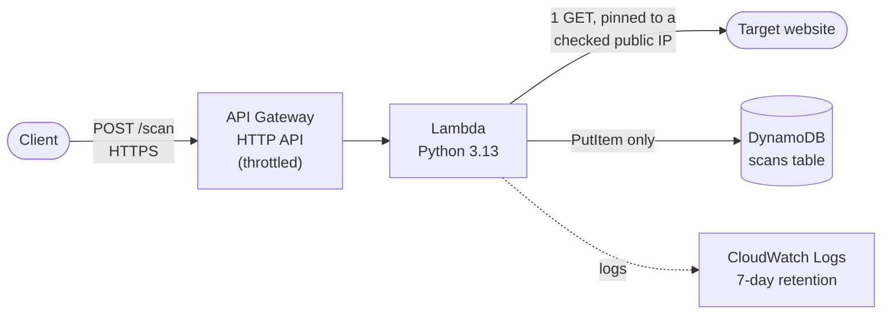

# sentinel-cloudcheck

[](https://github.com/ZukoG/sentinel-cloudcheck/actions/workflows/ci.yml)

A small serverless API on AWS that grades a website's HTTP security
headers. Send it a URL, and an AWS Lambda function fetches that page
once, scores six security headers, stores the result in DynamoDB, and
returns the grade as JSON. The whole stack is defined in Terraform:
one command creates it, one command removes it.

Built for a Cloud Computing elective, as a companion to
[sentinel-secscan](https://github.com/ZukoG/sentinel-secscan).

## Why

Missing security headers are one of the most common, and easiest to
fix, web misconfigurations. This project checks them with a real cloud
deployment end to end: serverless compute, a managed API, a managed
database, least-privilege IAM, infrastructure as code, and CI, all
inside the AWS free tier.

It is passive only: one ordinary GET request per scan, no payloads, no
crawling, no attacks.

## Architecture



| Resource | Purpose |
|---|---|
| API Gateway (HTTP API) | Public HTTPS endpoint, one route (`POST /scan`), throttled to 2 req/s, burst 5 |
| Lambda | Validates the URL, fetches the target, grades the headers, stores the result |
| DynamoDB | One item per scan, provisioned at 1 read and 1 write unit (always free) |
| IAM role | Can write only its own logs and `PutItem` into only its own table |
| CloudWatch Logs | Lambda logs, deleted after 7 days and on `terraform destroy` |

All 10 resources live in [`infra/main.tf`](infra/main.tf).

## What it checks

| Header | Passes when |
|---|---|
| `Strict-Transport-Security` | `max-age` is at least 180 days |
| `Content-Security-Policy` | present and not empty |
| `X-Content-Type-Options` | `nosniff` |
| `X-Frame-Options` | `DENY` or `SAMEORIGIN`, or the CSP has `frame-ancestors` |
| `Referrer-Policy` | `no-referrer`, `same-origin`, `strict-origin`, or `strict-origin-when-cross-origin` |
| `Permissions-Policy` | present and not empty |

Score is the share of checks passed (0 to 100). Grade: **A** 90+,
**B** 75+, **C** 60+, **D** 40+, **F** below 40. Full rules are in
[SRS section 4](docs/SRS.md#4-functional-requirements).

## Quick start

### Prerequisites

- An AWS account with an IAM user (not root) and the
  [AWS CLI v2](https://docs.aws.amazon.com/cli/latest/userguide/getting-started-install.html)
  configured via `aws configure`. Check it with `aws sts get-caller-identity`.
- [Terraform](https://developer.hashicorp.com/terraform/install) 1.6 or newer.
- Python 3.12 or newer, only for running the tests.

### 1. Deploy

```bash
git clone https://github.com/ZukoG/sentinel-cloudcheck.git
cd sentinel-cloudcheck/infra
terraform init
terraform apply
```

Type `yes` when asked. It takes under a minute and ends with:

```
Apply complete! Resources: 10 added, 0 changed, 0 destroyed.

Outputs:

function_name = "sentinel-cloudcheck-scanner"
scan_url = "https://<api-id>.execute-api.eu-west-1.amazonaws.com/scan"
table_name = "sentinel-cloudcheck-scans"
```

The default region is `eu-west-1`. To use another one, run
`terraform apply -var="aws_region=<region>"`.

### 2. Scan a site

**Windows PowerShell** (in PowerShell, `curl` is a different command,
so use `Invoke-RestMethod`):

```powershell
$url = terraform output -raw scan_url
Invoke-RestMethod -Method Post -Uri $url -ContentType "application/json" -Body '{"url": "https://github.com"}' | ConvertTo-Json -Depth 5
```

**Linux, macOS, or Git Bash:**

```bash
URL=$(terraform output -raw scan_url)
curl -s -X POST "$URL" -H "Content-Type: application/json" -d '{"url": "https://github.com"}'
```

Real response from a live deployment:

```json
{
    "scan_id": "b91fabd3-8b79-449a-bfa6-607314e35de0",
    "url": "https://github.com",
    "status_code": 200,
    "score": 83,
    "grade": "B",
    "checks": [
        {"header": "Strict-Transport-Security", "passed": true, "detail": "max-age=31536000 meets the 180-day minimum"},
        {"header": "Content-Security-Policy", "passed": true, "detail": "Header is present"},
        {"header": "X-Content-Type-Options", "passed": true, "detail": "Value is nosniff"},
        {"header": "X-Frame-Options", "passed": true, "detail": "X-Frame-Options provides framing protection"},
        {"header": "Referrer-Policy", "passed": true, "detail": "Final policy 'strict-origin-when-cross-origin' is accepted"},
        {"header": "Permissions-Policy", "passed": false, "detail": "Header is missing or empty"}
    ],
    "scanned_at": "2026-10-22T05:03:57.783295+00:00"
}
```

Errors come back as JSON too. Also captured from the live deployment:

| Request `url` | Status | Response |
|---|---|---|
| `http://169.254.169.254/latest/meta-data/` | 400 | `{"error": "URL must point to a public address"}` |
| `ftp://example.com` | 400 | `{"error": "URL scheme must be http or https"}` |
| `https://does-not-exist.invalid` | 502 | `{"error": "Unable to reach target"}` |

Only successful scans are stored. The DynamoDB table after the scans
above:

```
+-------+--------+-------------------------------+
| grade | score  |              url              |
+-------+--------+-------------------------------+
|  B    |  83    |  https://github.com           |
|  A    |  100   |  https://www.cloudflare.com   |
+-------+--------+-------------------------------+
```

### 3. See it in the AWS console

Make sure the region selector (top right) matches the deployed region,
**Europe (Ireland)** by default, or everything will look empty.

- **DynamoDB**, then Explore items, then `sentinel-cloudcheck-scans`: one item per scan
- **Lambda**, then `sentinel-cloudcheck-scanner`: the function and its Monitor tab
- **CloudWatch**, then Log groups, then `/aws/lambda/sentinel-cloudcheck-scanner`: one log stream per run
- **API Gateway**, then `sentinel-cloudcheck-api`: the route and throttling settings

### 4. Tear it down

```bash
terraform destroy
```

Type `yes`. It ends with `Destroy complete! Resources: 10 destroyed.`
and removes everything, logs included. To double-check nothing is
left, `terraform state list` should print nothing. More ways to verify
are in [Security and Cost](docs/SECURITY_AND_COST.md#6-teardown).

## Running the tests

The 49 unit tests need no AWS account and no internet: DNS, fetching,
and DynamoDB are all faked, plus one local HTTP server.

```bash
python -m venv .venv
.venv\Scripts\activate        # PowerShell; Git Bash: source .venv/Scripts/activate; Linux/macOS: source .venv/bin/activate
pip install -r requirements-dev.txt
python -m pytest -v
```

CI runs the same tests on Python 3.13, plus `terraform fmt -check` and
`terraform validate`, on every pull request. CI never needs AWS
credentials.

## Security

A service that fetches any URL a stranger sends it can be abused to
reach things inside the cloud provider (server-side request forgery,
SSRF). This one defends in layers:

- Only `http`/`https`, at most 2048 characters.
- The hostname is resolved first, and rejected if **any** address is
  private, loopback, link-local (including the `169.254.169.254` cloud
  metadata address), or otherwise non-public. This also catches tricks
  like `http://2130706433/` or a public name pointing at `127.0.0.1`.
- The fetch connects to the exact IP that was checked, so a hostile DNS
  server cannot swap in a private address afterwards (DNS rebinding).
  TLS certificates are still fully verified against the hostname.
- Redirects are never followed.
- The Lambda's IAM role can do two things only: write its own logs and
  `PutItem` into its own table.

Details, including what was tested against the live API, are in
[docs/SECURITY_AND_COST.md](docs/SECURITY_AND_COST.md).

## Cost

Every resource sits inside the AWS free tier at demo scale, and
`terraform destroy` removes all of it. A per-service breakdown is in
[docs/SECURITY_AND_COST.md](docs/SECURITY_AND_COST.md#5-cost-nfr-3).

## Project structure

```
src/
  grader.py        pure grading logic, no network or AWS
  handler.py       Lambda entry point: validate, resolve, fetch, grade, store
tests/
  test_grader.py
  test_handler.py
infra/
  main.tf          all AWS resources
  variables.tf     region, name prefix, log retention, throttling
  outputs.tf       scan_url, table_name, function_name
docs/
  SRS.md                 requirements
  SECURITY_AND_COST.md   IAM, SSRF defences, throttling, cost, teardown
.github/workflows/ci.yml tests and Terraform checks
```

## Troubleshooting

| Problem | Fix |
|---|---|
| `terraform` or `aws` is "not recognized" right after installing | Close and reopen the terminal so it picks up the new PATH |
| `pip install` fails on Windows with a long path error | Clone into a shorter folder (for example `C:\Users\<you>\Desktop`). botocore's data files have very long names |
| The AWS console shows nothing | Switch the region selector to the deployed region (Europe (Ireland) by default) |
| `429 Too Many Requests` or `503` | You hit the API throttle or the account's Lambda concurrency limit. Wait a second and retry |

## Documentation

- [Software Requirements Specification](docs/SRS.md)
- [Security and Cost](docs/SECURITY_AND_COST.md)

## License

[MIT](LICENSE)
